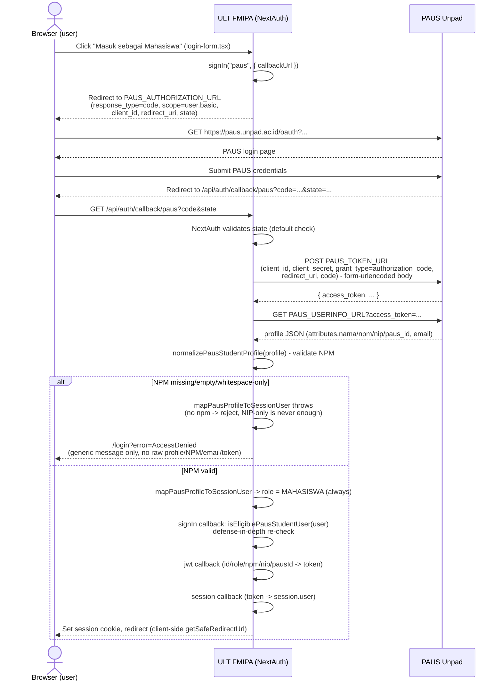
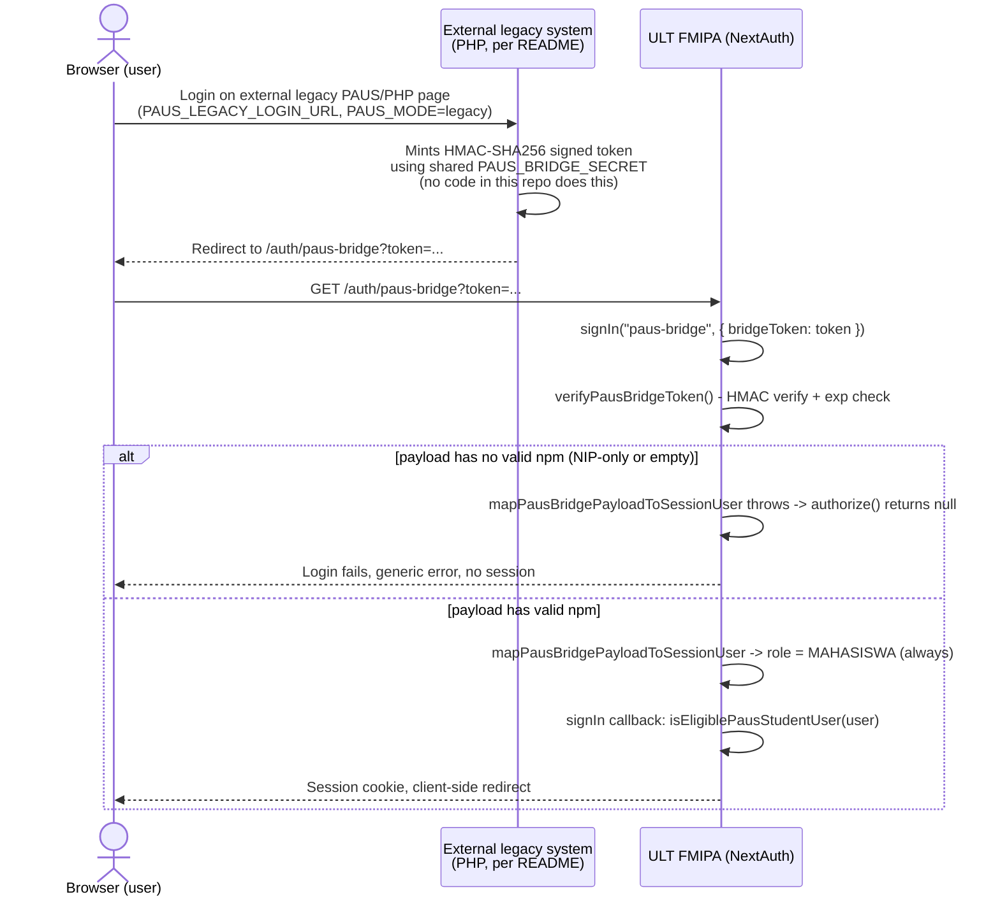

# PAUS Integration Audit

> Audit date: 2026-08-09, updated 2026-08-09 after the final business rule
> below was confirmed and implemented. Scope: authentication/authorization
> code only, no database schema change, no migration, no deployment. Every
> conclusion below is tagged with a status:
>
> - **VERIFIED FROM CODE** - read directly from the files listed.
> - **VERIFIED FROM PROVIDED SPEC** - matches the OAuth flow description
>   given for this task.
> - **NEEDS DPSI CONFIRMATION** - cannot be verified from code or the
>   provided spec; must be asked.
> - **RECOMMENDATION** - a suggested next step, not yet implemented.
> - **BLOCKER** - prevents a safe go-live of PAUS login as currently coded.
>
> This document does not print any secret value, token, or real PAUS user
> profile data.

## 1. Executive Summary

**Status: NEEDS DPSI CONFIRMATION** (not BLOCKED, not READY) for the
remaining OAuth-mechanics questions - but the authorization gap this audit
originally found (Finding S-1) is **RESOLVED IN CODE** on this branch.

**Final business rule (confirmed, no longer a question):**

| Pengguna | Metode Login | Sumber Role |
|---|---|---|
| Mahasiswa | PAUS OAuth (or PAUS Bridge, legacy) | Always `MAHASISWA` |
| Staff | Credentials Provider (internal `data_users`) | `data_users.APP_ROLE` |
| Admin | Credentials Provider (internal `data_users`) | `data_users.APP_ROLE` |

PAUS (both the modern OAuth provider and the legacy Bridge) is **student-
only**. It can never produce `STAFF` or `ADMIN`, and it now requires a
non-empty NPM before a session is created at all - a PAUS profile with only
a `nip` (no `npm`) is rejected outright, not silently downgraded. Staff and
Admin authentication remains exclusively the Credentials Provider backed by
`data_users`/`APP_ROLE`; nothing about that path changed.

The application already has a working, code-complete PAUS OAuth 2.0
Authorization Code Flow implementation (`src/lib/auth.ts`,
`src/lib/paus-profile.ts`) that matches the flow described for this task
(browser → PAUS authorization → callback with `code`/`state` → server-side
token exchange → userinfo fetch → session, now with student-only
validation before the session is created). It is currently **inactive**
because `PAUS_CLIENT_ID`/`PAUS_CLIENT_SECRET` are empty everywhere (local
dev, local staging, and the Kubernetes secret template) - this is expected
and does not crash the app (`hasPausOAuthConfig()` guards provider
registration).

One thing still needs to happen before this can go live:

- **DPSI must confirm the open questions in
  [`docs/dpsi-paus-integration-checklist.md`](dpsi-paus-integration-checklist.md)**
  - several OAuth-mechanics implementation details (token client-auth
  method, userinfo token transport, OIDC vs. plain OAuth, PKCE, scope
  completeness, the exact JSON path for the student email, and whether it's
  always present) are implemented as reasonable guesses in the existing
  code but have never been confirmed or tested against the real PAUS
  service. None of these affect the student-only role policy, which is now
  enforced independently of what PAUS returns for email/scope/transport.

NPM is required for a PAUS session; email is mapped when PAUS provides it
(top-level `email` field, unchanged from before) but is **not** required
and is **never** used as an identifier or to influence role - see §2 ("Email
mapping" subsection) below.

## 2. Current Implementation

Verified from `src/lib/auth.ts`, `src/lib/paus-profile.ts`,
`src/lib/paus-bridge-token.ts`, `src/lib/auth-db-users.ts`,
`src/lib/roles.ts`, `src/proxy.ts`, `src/app/login/login-form.tsx`,
`src/app/auth/paus-bridge/*`, `src/types/next-auth.d.ts`.

| Item | Value | Status |
|---|---|---|
| NextAuth route | `src/app/api/auth/[...nextauth]/route.ts` - default `NextAuth(authOptions)` handler, no custom logic | VERIFIED FROM CODE |
| Providers registered | 1. `CredentialsProvider` (unnamed id -> `credentials`, "Development Credentials" - DEV_\* bypass + DB users via `authorizeDbCredentialUser`) 2. `CredentialsProvider({ id: "paus-bridge", ... })` 3. `paus` OAuth provider, only if `hasPausOAuthConfig()` is true | VERIFIED FROM CODE |
| PAUS OAuth provider ID | `"paus"` (`createPausProvider()` returns `{ id: "paus", ... }`) | VERIFIED FROM CODE |
| Condition for PAUS OAuth provider to register | `getPausMode() === "modern" && process.env.PAUS_CLIENT_ID && process.env.PAUS_CLIENT_SECRET` (`hasPausOAuthConfig()`) | VERIFIED FROM CODE |
| `PAUS_MODE` values | `"legacy"` -> legacy; anything else (including unset) -> `"modern"` (`getPausMode()`) | VERIFIED FROM CODE |
| Authorization URL used | `process.env.PAUS_AUTHORIZATION_URL \|\| "https://paus.unpad.ac.id/oauth"` | VERIFIED FROM CODE, matches given spec |
| Token URL used | `process.env.PAUS_TOKEN_URL \|\| "https://paus.unpad.ac.id/oauth/access-token"` | VERIFIED FROM CODE, matches given spec |
| Userinfo URL used | `process.env.PAUS_USERINFO_URL \|\| "https://paus.unpad.ac.id/api/"` | VERIFIED FROM CODE, matches given spec (spec says `.../api`, code defaults to `.../api/` with trailing slash - see Gap G-9) |
| Sign-out URL | `process.env.PAUS_SIGN_OUT_URL \|\| "https://paus.unpad.ac.id/oauth/sign-out"` - declared but **never used** for any actual sign-out call (only in a debug log line and a `// TODO(PAUS)` comment) | VERIFIED FROM CODE |
| Issuer / discovery | `issuer: process.env.PAUS_ISSUER` is set on the `OAuthConfig` object, but provider `type` is `"oauth"` (not `"oidc"`), there is no `wellKnown` URL, and no `idToken`/nonce handling. NextAuth v4 only performs OIDC discovery/issuer validation for `type: "oidc"` providers. As configured, `PAUS_ISSUER` has **no functional effect** on the current flow. | VERIFIED FROM CODE |
| OAuth checks | Not overridden (`checks` key absent from the provider config). NextAuth v4 default for `type: "oauth"` providers is `checks: ["state"]`. PKCE (`"pkce"`) and `"nonce"` are **not** enabled. | VERIFIED FROM CODE + framework default behavior |
| Scope | `"user.basic"` (single string, hardcoded) | VERIFIED FROM CODE |
| `response_type` | `"code"` | VERIFIED FROM CODE, matches spec |
| Token endpoint client auth | `client.token_endpoint_auth_method: "client_secret_post"`; matching custom `token.request()` sends `client_id`/`client_secret`/`grant_type`/`redirect_uri`/`code` as `application/x-www-form-urlencoded` POST body (not HTTP Basic auth) | VERIFIED FROM CODE |
| `redirect_uri` sent to token endpoint | `provider.callbackUrl` (NextAuth-computed, `${NEXTAUTH_URL}/api/auth/callback/paus`) | VERIFIED FROM CODE |
| Userinfo request | Custom `userinfo.request()`: GET to `pausUserinfoUrl` with `access_token` appended as a **URL query parameter** (`url.searchParams.set("access_token", accessToken)`) - **not** an `Authorization: Bearer` header | VERIFIED FROM CODE |
| Profile mapper | `profile(profile) { return mapPausProfileToSessionUser(profile) }` (`src/lib/paus-profile.ts`) | VERIFIED FROM CODE |
| Session strategy | `session: { strategy: "jwt" }` - JWT-only, no database session table | VERIFIED FROM CODE |
| Session cookie | Not customized (no `cookies:` block) - uses NextAuth v4 defaults: `HttpOnly` always; `Secure` automatically enabled when `NEXTAUTH_URL` starts with `https://`; `SameSite=Lax` | VERIFIED FROM CODE (absence of override) + NextAuth v4 default behavior |
| Access token storage | Never assigned to `token.*` in the `jwt` callback and never assigned to `session.user.*` in the `session` callback - **not** exposed to the browser/client | VERIFIED FROM CODE |
| Refresh token | Not read, not stored, no refresh logic anywhere in `src/lib/auth.ts` | VERIFIED FROM CODE |
| PAUS profile persisted to DB? | No. `mapPausProfileToSessionUser` does not call `prisma` at all; the mapped user only lives in the JWT/session | VERIFIED FROM CODE |
| `jwt` callback | Copies `user.id/role/positionCode/accessCode/npm/nip/pausId/phone` onto `token` (only when `user` is present, i.e. on sign-in), and `account.provider` onto `token.provider` | VERIFIED FROM CODE |
| `session` callback | Copies the same fields from `token` onto `session.user`, plus `token.provider` | VERIFIED FROM CODE |
| `redirect` callback | **Not defined** - NextAuth's default same-origin redirect behavior applies. Actual "where does the user land" logic lives client-side in `getSafeRedirectUrl`/`getDefaultRedirectByRole` (`src/lib/auth-redirect.ts`), called from `login-form.tsx` and `paus-bridge-client.tsx` after `getSession()` | VERIFIED FROM CODE |
| `signIn` callback | **New.** For `account.provider === "paus"` or `"paus-bridge"`, returns `isEligiblePausStudentUser(user)` (`src/lib/auth-user-mapper.ts`) - `true` only if the already-mapped user has `role === "MAHASISWA"` and a non-empty `npm`. Returns `true` unconditionally for every other provider (`credentials`), so Admin/Staff/dev login is unaffected. This is a defense-in-depth re-check on top of the mapper-level validation below - if it returns `false`, NextAuth aborts sign-in and redirects to `/login?error=AccessDenied` (no session, no raw profile/token in the redirect) | VERIFIED FROM CODE |
| NPM/name/email mapping | `attributes.nama` -> `name`, `attributes.npm` -> `npm`, `attributes.nip` -> `nip`, `attributes.paus_id` -> `pausId`, top-level `email` -> `email`, and the `id` fallback chain is now `pausId -> profile.sub -> profile.id -> \`paus-npm-${npm}\`` (email removed from the identity fallback chain - NPM/PAUS-provided identifiers are the identity, not email) | VERIFIED FROM CODE |
| Role determination for PAUS OAuth | **Changed.** `normalizePausStudentProfile(profile)` (`src/lib/paus-profile.ts`) extracts and validates NPM first; `mapPausProfileToSessionUser` throws (rejecting sign-in) if no non-empty NPM is present, and otherwise **always** returns `role: "MAHASISWA"`. NIP is still mapped onto the session (informational) but never influences role. No `STAFF`/`ADMIN` path exists in this mapper at all, and there is still no database lookup - the "student-only" rule is enforced purely by requiring NPM, not by checking `data_users` | VERIFIED FROM CODE |
| Role determination for DB Credentials | Unchanged. `authorizeDbCredentialUser` (`src/lib/auth-db-users.ts`) looks up `data_users` by `USER_NAME`/`EMAIL`, requires `CONFIRMED === "1"`, verifies the legacy SHA-1 password hash, and resolves role via `resolveAppRole({ appRole: user.APP_ROLE, positionCode: user.ACCESS_CODE })` - i.e. `APP_ROLE` (or a legacy `ACCESS_CODE` fallback) from the database is the source of truth. Nothing in this file changed. | VERIFIED FROM CODE |
| DB Credentials vs. PAUS in the UI | The login page (`src/app/login/login-form.tsx`) has two entry points, relabeled to match the final business rule: **"Masuk sebagai Mahasiswa"** calls `signIn("paus", ...)` (modern) or redirects to `PAUS_LEGACY_LOGIN_URL` (legacy mode); **"Masuk sebagai Admin/Staff"** shows a username/password form that posts to the `credentials` provider (DB-backed Admin/Staff, or DEV_\* bypass). PAUS OAuth is **not** wired to the Admin/Staff form, and the copy no longer implies otherwise. | VERIFIED FROM CODE |
| PAUS Bridge purpose | A **separate, non-OAuth mechanism**: `/auth/paus-bridge?token=...` (client component) calls `signIn("paus-bridge", { bridgeToken: token })`, which HMAC-SHA256-verifies the token against `PAUS_BRIDGE_SECRET` (`src/lib/paus-bridge-token.ts`) and trusts the embedded payload (`npm`/`nip`/`name`/`email`/`exp`) directly - no PAUS server round-trip happens in this app for this path. Nothing in this repository *generates* a bridge token; it must be minted by an **external system** (README calls it "login PHP legacy") that independently knows `PAUS_BRIDGE_SECRET`. This bridge is legacy, not part of the DPSI OAuth integration, and is **not used for Admin/Staff** - it must not be enabled in any shared environment unless that external legacy flow is confirmed still in use. | VERIFIED FROM CODE |
| Bridge role determination | **Changed.** Same student-only rule as the OAuth mapper: `mapPausBridgePayloadToSessionUser` now requires a non-empty `npm` and throws otherwise; always returns `role: "MAHASISWA"`. A payload with `nip` but no `npm` is rejected, not downgraded to `STAFF`. | VERIFIED FROM CODE |
| Route-level authorization | Unchanged. `src/proxy.ts` (Next.js "proxy"/middleware) gates `/admin/:path*`, `/api/admin/:path*` to `role === "ADMIN"`; `/staff/:path*`, `/api/staff/:path*` to `role === "STAFF"`; `/mahasiswa/:path*`, `/api/student/:path*` to `role === "MAHASISWA"`; unauthenticated requests redirect to `/login` (or `401` for API routes) | VERIFIED FROM CODE |
| Open redirect protection | Unchanged. `getSafeRedirectUrl`/`isCallbackAllowedForRole` (`src/lib/auth-redirect.ts`) reject `callbackUrl` values starting with `//`, require same-origin for absolute URLs, and restrict the target path by role. No open redirect found. | VERIFIED FROM CODE |

### Email mapping (student profile)

- PAUS's top-level `email` field is mapped to `user.email` exactly as
  before (`profile.email` in `paus-profile.ts`, `payload.email` in
  `paus-bridge-token.ts`) - this mapping is unchanged, only trimmed and
  normalized to `undefined` when blank.
- Email is **never** required for a PAUS session to be created - only NPM
  is mandatory. If PAUS omits email, `user.email` is simply `undefined` and
  login still succeeds (as MAHASISWA, same as with email present).
- Email does **not** influence role in any way, and is not used as a
  fallback identifier - `user.id` is derived from `pausId`/`sub`/`id`/NPM,
  never from email (see the `id` fallback chain row above).
- No new field path (e.g. a hypothetical `attributes.email.attribute_value`
  nested shape) was added, because there is no evidence in code or official
  documentation that PAUS nests email under `attributes` the way it does
  `nama`/`npm`/`nip`/`paus_id`. Only the already-supported top-level
  `email` is read. Whether PAUS's userinfo response always includes email,
  under what exact JSON path, and whether it is verified, remains **NEEDS
  DPSI CONFIRMATION** (see the checklist).

## 3. Current OAuth Flow (from code)



This diagram is built strictly from `src/lib/auth.ts`,
`src/lib/paus-profile.ts`, and `src/app/login/login-form.tsx`; it
intentionally omits anything not present in code (no PKCE, no nonce, no
discovery call, no refresh token, no PAUS sign-out call). NIP is still
mapped onto the session object when present, but never appears in the role
decision - there is no `nip -> STAFF` branch anywhere in this flow anymore.

### 3a. Separate flow: PAUS Bridge (legacy, non-OAuth, also student-only)



This is **not** the OAuth 2.0 flow described in the task spec and does not
involve DPSI's authorization/token/userinfo endpoints at all. It depends on
an external system this repository does not contain. See Gap G-10.

## 4. OAuth Flow Expected (per provided spec)

1. User clicks login.
2. Browser redirected to PAUS login page.
3. User enters PAUS credentials.
4. PAUS returns `code` and `state` to the app's callback.
5. Server validates `state`.
6. Server exchanges `code` at the token endpoint.
7. PAUS returns `access_token`.
8. Server uses `access_token` to fetch the user profile.
9. App creates a session/cookie.

Endpoints given: authorization `https://paus.unpad.ac.id/oauth`, token
`https://paus.unpad.ac.id/oauth/access-token`, userinfo
`https://paus.unpad.ac.id/api`.

**This matches the current code's shape almost exactly** (see §3) - the
`paus` OAuth provider already implements steps 1-9 against the exact URLs
given. What the spec does **not** specify, and the code currently guesses
at, is covered in §5 and the DPSI checklist: token client-auth method,
userinfo token transport, scope completeness, PKCE, OIDC/discovery, and
profile field shape.

## 5. Gap Analysis

| Item | Current Code | Required (per spec) | Status | Gap / Question |
|---|---|---|---|---|
| Authorization endpoint | `https://paus.unpad.ac.id/oauth` (default) | `https://paus.unpad.ac.id/oauth` | MATCH | VERIFIED FROM PROVIDED SPEC |
| Token endpoint | `https://paus.unpad.ac.id/oauth/access-token` (default) | `https://paus.unpad.ac.id/oauth/access-token` | MATCH | VERIFIED FROM PROVIDED SPEC |
| Userinfo endpoint | `https://paus.unpad.ac.id/api/` (default, trailing slash) | `https://paus.unpad.ac.id/api` (no trailing slash in spec) | LIKELY MATCH | G-9: confirm trailing slash doesn't change the resource/behavior |
| Provider ID | `paus` | n/a (internal) | VERIFIED FROM CODE | none - just informs callback path (§6) |
| Callback URI | `/api/auth/callback/paus` (NextAuth convention for provider id `paus`) | not specified | VERIFIED FROM CODE | must be registered exactly per environment (§6) |
| Client ID / Secret | Read from `PAUS_CLIENT_ID`/`PAUS_CLIENT_SECRET`, currently empty everywhere | "Client ID dari DPSI" | NOT YET PROVIDED | G-1: obtain staging + production credentials |
| `redirect_uri` param | Sent on both authorize step (via NextAuth) and token exchange (`provider.callbackUrl`) | not specified | VERIFIED FROM CODE | G-2: confirm PAUS requires exact match, trailing-slash sensitivity, case sensitivity |
| `response_type` | `code` | Authorization Code Flow | MATCH | VERIFIED FROM PROVIDED SPEC |
| `grant_type` | `authorization_code` | implied by flow | MATCH | VERIFIED FROM PROVIDED SPEC |
| `state` | NextAuth default check enabled | "Server memvalidasi state" | MATCH | VERIFIED FROM CODE (framework default) |
| PKCE | Not enabled | not mentioned in spec | UNKNOWN | G-3: does PAUS require/support PKCE? |
| Scope | `user.basic` (hardcoded, single value) | not specified | UNCONFIRMED | G-4: is `user.basic` correct/sufficient for the profile fields the app needs (`nama`, `npm`, `nip`, `paus_id`, `email`)? |
| Token client authentication | `client_secret_post` (credentials in POST body) | not specified | UNCONFIRMED | G-5: does PAUS's token endpoint accept `client_secret_post`, or does it require HTTP Basic (`client_secret_basic`)? |
| Access token transport to userinfo | Query parameter `?access_token=...` | not specified ("Server menggunakan access_token untuk mengambil profil user" - method unspecified) | UNCONFIRMED | G-6: does PAUS's userinfo endpoint accept/require `Authorization: Bearer <token>` instead of/in addition to a query parameter? Query-string tokens risk being written to access/proxy logs. |
| Userinfo response shape | `{ sub?, id?, name?, email?, attributes: { [key]: { attribute_value } } }` | not specified | UNCONFIRMED | G-7: confirm this nested `attributes.<key>.attribute_value` shape is accurate for real PAUS responses, and whether dosen/staff responses use the same shape |
| OIDC / discovery | Not used (`type: "oauth"`, no `wellKnown`, `PAUS_ISSUER` inert) | not specified | UNCONFIRMED | G-8: is PAUS OIDC-capable (`/.well-known/openid-configuration`)? If yes, should the provider be migrated to `type: "oidc"`? (`PAUS_ISSUER` must not be relied on until this is answered - already the project's own stated rule) |
| Refresh token | Not implemented | not mentioned in spec | N/A UNLESS CONFIRMED NEEDED | G-11: is a refresh token issued? Is the current single-session-lifetime (JWT, no refresh) acceptable? |
| Logout / revocation | `PAUS_SIGN_OUT_URL` declared, never called; app-only `signOut()` clears local cookie only | not mentioned in spec | GAP | G-12: does logging out of the app need to also invalidate the PAUS-side session/token? |
| Legacy PAUS bridge | Separate HMAC mechanism, external token issuer not in this repo | not part of given spec | OUT OF SCOPE FOR THIS INTEGRATION | G-10: confirm whether the legacy bridge is still needed alongside the new OAuth integration, or should be retired |

## 6. Callback URI Matrix

Derived from the verified provider ID `paus` (`/api/auth/callback/<id>` is a
fixed NextAuth v4 convention) and `NEXTAUTH_URL` per environment.

| Environment | `NEXTAUTH_URL` | Callback URI | Register with DPSI? |
|---|---|---|---|
| Local development | `http://localhost:3000` (`.env.example`) | `http://localhost:3000/api/auth/callback/paus` | Only if DPSI explicitly allows `http://localhost` callbacks for developer testing - **ask** (see DPSI checklist B.4/B.5) |
| Local staging | `http://localhost:3100` (`staging-local.env.example`) | `http://localhost:3100/api/auth/callback/paus` | Same as above - localhost, likely not registrable with a production-grade OAuth provider; treat local staging as PAUS-OAuth-disabled unless DPSI confirms otherwise |
| VPS staging | `https://<DOMAIN_STAGING>` (not yet assigned) | `https://<DOMAIN_STAGING>/api/auth/callback/paus` | **Yes** - required before any staging PAUS test |
| Production | `https://ult.fmipa.unpad.ac.id` (per task instructions; not yet confirmed as the final domain in repo config) | `https://ult.fmipa.unpad.ac.id/api/auth/callback/paus` | **Yes** - required before go-live |

Open questions (all NEEDS DPSI CONFIRMATION, see checklist section B):

- Exact-match requirement and case sensitivity of the redirect URI.
- Whether a trailing slash changes matching.
- Whether more than one callback URI can be registered per client (useful
  for allowing both staging and production under one client, or not).
- Whether `http://localhost` callbacks are permitted at all for developer
  testing, and if so under what client.
- Whether staging and production **must** use separate Client IDs (assumed
  yes, standard practice, but not yet confirmed).
- Whether wildcard callback URIs are supported (assumed no, standard OAuth
  practice; must not be relied upon).

## 7. Environment Variable Matrix

All variable names below are copied verbatim from `src/lib/auth.ts`,
`.env.example`, `docker-compose.yml`, `docker-compose.staging-local.yml`,
`staging-local.env.example`, and the `k8s/` manifests. None were invented.

| Variable | Used in | Local Dev | Local Staging | VPS Staging | Production | Secret? | Required for PAUS OAuth? | Value source |
|---|---|---|---|---|---|---|---|---|
| `NEXTAUTH_URL` | `src/lib/auth.ts` (`redirect_uri` derivation), NextAuth core | `http://localhost:3000` | `http://localhost:3100` | `https://<DOMAIN_STAGING>` | `https://ult.fmipa.unpad.ac.id` | No | Yes (determines callback URI) | Project convention per environment |
| `NEXTAUTH_SECRET` | NextAuth core (JWT signing) | `.env.example` placeholder | generated by `staging-local.env` (gitignored) | must be generated fresh | must be generated fresh | **Yes** | Indirectly (session integrity) | Generated by project (`openssl rand` / `crypto.randomBytes`), unique per environment |
| `AUTH_DEBUG` | `src/lib/auth.ts:47` (`logPausProviderStatus`) | optional, `false` default | `false` (overlay) | `false` | `false` | No | No (debug only, booleans only, never logs secret values) | Developer |
| `PAUS_MODE` | `src/lib/auth.ts` (`getPausMode`), `src/app/login/page.tsx` | `modern` default | `modern` (inherited) | `modern` (once confirmed) | `modern` (once confirmed) | No | Yes (`modern` required for OAuth provider) | DPSI confirms which mode to use per environment |
| `PAUS_CLIENT_ID` | `src/lib/auth.ts` (`hasPausOAuthConfig`, `createPausProvider`) | empty (dev, not usable) | empty unless DPSI issues a test client | staging client ID | production client ID | **Yes** (not secret-strength like a password, but must not be shared publicly) | Yes | **DPSI/Tim PAUS Unpad** |
| `PAUS_CLIENT_SECRET` | same as above | empty | empty unless DPSI issues one | staging client secret | production client secret | **Yes (secret)** | Yes | **DPSI/Tim PAUS Unpad** |
| `PAUS_AUTHORIZATION_URL` | `src/lib/auth.ts` | default `https://paus.unpad.ac.id/oauth` | same | same (confirm no staging-specific URL) | same | No | Yes (has a working default) | `.env.example` default, confirm with DPSI if a distinct staging endpoint exists |
| `PAUS_TOKEN_URL` | `src/lib/auth.ts` | default | same | same | same | No | Yes | `.env.example` default |
| `PAUS_USERINFO_URL` | `src/lib/auth.ts` | default | same | same | same | No | Yes | `.env.example` default |
| `PAUS_SIGN_OUT_URL` | declared, unused | default | default | default | default | No | No (dead code today) | `.env.example` default |
| `PAUS_ISSUER` | `src/lib/auth.ts` (`issuer` field, currently inert) | empty | empty (overlay sets `${PAUS_ISSUER:-}`) | **do not set until confirmed** | **do not set until confirmed** | No | Not currently (no OIDC discovery wired up) | **DPSI**, only after G-8 is answered |
| `PAUS_LEGACY_LOGIN_URL` | `src/app/login/page.tsx`, `login-form.tsx` | empty | empty | only if legacy bridge stays in use | only if legacy bridge stays in use | No | No (only for the separate legacy bridge flow, §3a) | Owner of the external legacy system |
| `PAUS_BRIDGE_SECRET` | `src/lib/paus-bridge-token.ts` | dev placeholder, must not be `"change-me"` in any real environment (code explicitly rejects that literal value) | generated random (`staging-local.env`, gitignored) | must be generated fresh, **and shared with the external legacy system** if that flow stays in use | must be generated fresh, shared with external system | **Yes (secret)** | No (only for the legacy bridge, §3a) | Generated by project, must match whatever the external legacy system uses |
| `PAUS_BRIDGE_TOKEN_TTL_SECONDS` | not read by `paus-bridge-token.ts` today (verify - see note below) | `120` default | inherited | inherited | inherited | No | No | Developer |

> Note on `PAUS_BRIDGE_TOKEN_TTL_SECONDS`: `src/lib/paus-bridge-token.ts`
> validates `payload.exp` (an absolute Unix timestamp *embedded in the
> token itself*, presumably set by whatever external system mints it) but
> does not read `process.env.PAUS_BRIDGE_TOKEN_TTL_SECONDS` anywhere in this
> file. This env var therefore currently has **no effect in this
> repository's code** - it is likely meant to inform the external legacy
> token issuer of the expected TTL convention, not to be consumed here.
> VERIFIED FROM CODE (absence of usage).

### Environment differences

- **Local development**: `http://localhost:3000` callback; PAUS OAuth
  provider not registered unless a developer manually sets
  `PAUS_CLIENT_ID`/`PAUS_CLIENT_SECRET` (not typical - `DEV_STUDENT_*`
  bypass exists specifically so PAUS isn't needed for local dev).
- **Local staging**: `http://localhost:3100` callback; same guard applies.
  Do not use production/staging PAUS credentials here even if DPSI provides
  a sandbox client, unless the sandbox client explicitly allows a localhost
  callback.
- **VPS staging**: requires a real HTTPS domain, its own `PAUS_CLIENT_ID`/
  `PAUS_CLIENT_SECRET` (assume separate from production until DPSI says
  otherwise), and the exact callback URI registered with DPSI before any
  test.
- **Production**: separate credentials from staging, separate
  `NEXTAUTH_SECRET`, callback URI registered, HTTPS mandatory (see §9,
  Finding S-4).

## 8. File Configuration Map

| File | Function | What it sets | Secret allowed? | Changes at staging | Changes at production |
|---|---|---|---|---|---|
| `src/lib/auth.ts` | NextAuth options, PAUS provider definition | Provider list, callbacks, endpoint defaults | No (reads from `process.env` only) | none (env-driven) | none (env-driven) |
| `src/app/api/auth/[...nextauth]/route.ts` | NextAuth HTTP handler | n/a | No | none | none |
| `src/proxy.ts` | Route-level role gate | n/a | No | none | none |
| `.env.example` | Tracked template for local dev `.env` | Placeholder values, PAUS URLs default-filled, `PAUS_CLIENT_ID`/`SECRET` blank | No (must stay placeholder) | copy to `.env`, fill DPSI-provided sandbox creds if any | n/a (not used in prod) |
| `staging-local.env.example` | Tracked template for local staging | Same PAUS vars, `NEXTAUTH_URL=http://localhost:3100` | No | copy to `staging-local.env` (gitignored) | n/a |
| `.env` | Actual local dev runtime config | Real (dev-grade) values | **Yes, at runtime** | n/a - **do not read or print** | n/a |
| `staging-local.env` | Actual local staging runtime config | Real (local-only) values | **Yes, at runtime** | n/a - **do not read or print** | n/a |
| `docker-compose.yml` | Base Compose service definitions | `PAUS_MODE`/URLs default-filled via `${VAR:-default}`, `PAUS_CLIENT_ID`/`SECRET` default empty | No (substitution only, values come from env file) | used as-is by staging-local overlay | not used directly (K8s used instead per `k8s/`) |
| `docker-compose.staging-local.yml` | Local staging overlay | Adds `PAUS_ISSUER` passthrough, keeps `PAUS_CLIENT_ID`/`SECRET` empty-by-default, `NEXTAUTH_URL=http://localhost:3100` | No | this **is** the staging-local config | n/a |
| `k8s/01-secrets.yaml` | K8s Secret template (tracked) | `PAUS_CLIENT_ID: ""`, `PAUS_CLIENT_SECRET: ""`, `PAUS_BRIDGE_SECRET: change-me`, `NEXTAUTH_SECRET: change-me` | **Placeholders only - must be replaced before real use**, never commit real values here | replace placeholders with staging DPSI credentials in a real (not tracked) apply, or via a secret manager | replace with production DPSI credentials, separate from staging |
| `k8s/02-configmap.yaml` | K8s ConfigMap (tracked) | `PAUS_MODE`, `PAUS_AUTHORIZATION_URL`/`TOKEN_URL`/`USERINFO_URL`/`SIGN_OUT_URL`, `NEXTAUTH_URL: https://ult-fmipa.example.com` (placeholder domain). **Note: `PAUS_ISSUER` is not present in this file at all** (inconsistent with `.env.example`/compose, but harmless since it's currently inert - see §5 G-8) | No | update `NEXTAUTH_URL` to the real staging domain | update `NEXTAUTH_URL` to the real production domain |
| `k8s/06-app.yaml` | App Deployment | Wires `envFrom: [configMapRef, secretRef]` - no PAUS-specific logic | No | none | none |
| `k8s/07-ingress.yaml` | Ingress | `host: ult-fmipa.example.com`, **no `spec.tls` block at all** | No | must add TLS/host for staging domain (see Finding S-4) | must add TLS/host for production domain |
| `README.md` | Human-facing setup doc | Documents PAUS env vars, states "belum aktif" (not active) | No | update once PAUS is enabled | update once PAUS is enabled |
| `docs/production-deployment-guide.md` | Deployment/readiness doc | Already contains a detailed "## 9. Setup PAUS SSO" section, cross-checked accurate against code in this audit | No | keep in sync with this audit's findings | same |
| `docs/local-staging-rehearsal.md` | Local staging runbook | States PAUS may be left blank for DB-only login rehearsal | No | none needed | n/a |
| `docs/paus-integration-audit.md` (this file) | Audit record | n/a | No | n/a | n/a |
| `docs/dpsi-paus-integration-checklist.md` | DPSI handoff | n/a | No | n/a | n/a |

## 9. Security Findings

### S-1. PAUS OAuth could grant STAFF role without any database record

**Severity before fix: BLOCKER** (blocked safely enabling PAUS for anything
beyond `MAHASISWA`). **Status: RESOLVED IN CODE** on this branch
(`fix/paus-student-only-auth`).

The business rule was confirmed as final: **PAUS is student-only.** Staff
and Admin authenticate exclusively through the Credentials Provider backed
by `data_users`/`APP_ROLE`.

**What was wrong (as originally audited):**

`mapPausProfileToSessionUser` (`src/lib/paus-profile.ts`, previous version):

```ts
role: npm ? "MAHASISWA" : nip ? "STAFF" : "MAHASISWA"
```

and `mapPausBridgePayloadToSessionUser` (`src/lib/paus-bridge-token.ts`,
previous version):

```ts
role: npm ? "MAHASISWA" : "STAFF"
```

Neither function queried `data_users`, `data_access`, or any other table.
The resulting `STAFF` role was written straight into the JWT/session and
trusted as-is by `requireRole(["STAFF"])` and `src/proxy.ts`'s
`isStaffPath` check. Anyone whose PAUS profile happened to include a `nip`
attribute (and no `npm`) would have been granted the application's `STAFF`
role and could reach every `/staff/*` page and `/api/staff/*` route,
without ever having a row in `data_users`, an `APP_ROLE` set by an Admin,
or any Admin having provisioned that account. `ADMIN` was never reachable
via either mapper - that part of least-privilege was already correct.

**Resolution implemented in this branch:**

- `normalizePausStudentProfile()` (`src/lib/paus-profile.ts`) extracts and
  validates NPM first (trimmed, non-empty). `mapPausProfileToSessionUser`
  now **throws** - rejecting the sign-in entirely, no session created - if
  no valid NPM is present. NIP is still mapped as informational metadata
  but **never** influences role.
- `mapPausBridgePayloadToSessionUser()` (`src/lib/paus-bridge-token.ts`)
  applies the identical rule: throws (which the `paus-bridge` Credentials
  provider's `authorize()` already turns into a safe `null` return) unless
  a valid NPM is present.
- Both mappers now **always** return `role: "MAHASISWA"` once a valid NPM
  is confirmed - there is no `STAFF` (or `ADMIN`) branch left in either
  function.
- A new `signIn` callback in `authOptions.callbacks` (`src/lib/auth.ts`)
  adds defense in depth: for `account.provider === "paus"` or
  `"paus-bridge"`, it independently re-checks
  `isEligiblePausStudentUser(user)` (`src/lib/auth-user-mapper.ts` -
  `role === "MAHASISWA" && Boolean(user.npm?.trim())`) and returns `false`
  (aborting sign-in) if that check fails, even if a future edit to either
  mapper were to regress. Every other provider (`credentials`) is
  unaffected - the callback returns `true` unconditionally for them, so
  Admin/Staff/dev login behavior is unchanged.
- `data_users`/`APP_ROLE` remains, unmodified, the **only** source of
  `STAFF`/`ADMIN` authorization (via `authorizeDbCredentialUser` in
  `src/lib/auth-db-users.ts`, which this branch does not touch).

Covered by `tests/paus-integration-audit.test.mjs` (updated) with direct
execution of the mapper functions - not just source-text assertions - for
positive (valid NPM), negative (NIP-only, empty NPM, whitespace NPM,
malformed profile), and never-STAFF/never-ADMIN cases, on both the OAuth
mapper and the Bridge mapper.

### S-2. Access token sent as a URL query parameter to the userinfo endpoint (MEDIUM, NEEDS DPSI CONFIRMATION)

`src/lib/auth.ts` userinfo `request()`:

```ts
const url = new URL(pausUserinfoUrl);
url.searchParams.set("access_token", accessToken);
const response = await fetch(url);
```

Sending bearer-style tokens in a URL query string is a well-known anti-
pattern (risk of the token landing in server access logs, proxy logs, or
`Referer` headers of any resource that URL might link out to). This may be
what PAUS's userinfo endpoint actually requires (some legacy or simple APIs
only support this), so it is not necessarily a bug - but it must be
confirmed with DPSI whether an `Authorization: Bearer` header is supported
instead. See checklist E.

### S-3. Secret handling in logs and code - no issues found (INFO)

**Status: VERIFIED FROM CODE.**

- `logPausProviderStatus()` (`src/lib/auth.ts:44-67`) only logs booleans
  (`Boolean(process.env.PAUS_CLIENT_ID)`, etc.) and non-secret URLs, and
  only runs when `NODE_ENV === "development" && AUTH_DEBUG === "true"` - it
  will not fire in staging/production by default and never prints the
  client secret or an access token.
- The token-exchange error handler
  (`console.error("[auth:paus] token request failed", ...)`) only logs the
  HTTP status and the PAUS-provided `error`/`message` fields from a failed
  response body - not the request body, not any secret, not the raw
  tokens.
- No `NEXT_PUBLIC_*` variable contains `PAUS_CLIENT_SECRET` or any other
  PAUS secret (grep confirms zero matches).
- Access token and refresh token are never assigned into the JWT `token` or
  `session.user` objects, so they never reach the browser.
- `PAUS_BRIDGE_SECRET` verification explicitly rejects the literal string
  `"change-me"` (`src/lib/paus-bridge-token.ts:44`), preventing the
  documented default placeholder from ever being treated as a valid secret
  at runtime.

### S-4. Kubernetes Ingress has no TLS configuration (HIGH, infra gap)

**Status: VERIFIED FROM CODE (`k8s/07-ingress.yaml`).**

The tracked ingress manifest has no `spec.tls` block and no
cert-manager/Let's-Encrypt annotations - only a plain HTTP-shaped rule for
the placeholder host `ult-fmipa.example.com`. PAUS OAuth callback URIs are
expected to be HTTPS (also stated in
`docs/production-deployment-guide.md`). This must be completed (TLS
certificate + ingress TLS block) before any staging/production PAUS
callback can be registered or tested - this is an infrastructure gap, not
a code bug, and is already flagged generally by
`docs/production-deployment-guide.md` §10, but this audit specifically
calls out that the tracked ingress YAML itself does not yet reflect it.

### S-5. No PAUS-side logout / revocation is triggered (LOW/INFO)

**Status: VERIFIED FROM CODE.** `PAUS_SIGN_OUT_URL` is declared and logged
but never called by `signOut()` (`src/components/layout/logout-button.tsx`)
or anywhere else. Logging out of this app only clears the local NextAuth
session cookie; the user's PAUS-side session (if any) remains active. See
checklist H.2.

### S-6. Session/cookie configuration relies entirely on NextAuth v4 defaults (INFO, not a finding of concern)

**Status: VERIFIED FROM CODE (absence of custom `cookies:` block) +
framework default behavior.** `HttpOnly` is always on; `Secure` turns on
automatically once `NEXTAUTH_URL` is `https://`; `SameSite=Lax`. This is
adequate as long as `NEXTAUTH_URL` is correctly set to `https://` in
staging/production (operational responsibility, not a code defect) and the
reverse proxy forwards `X-Forwarded-Proto: https` correctly (already
covered in `docs/production-deployment-guide.md` §10).

### S-7. Authorization-code reuse / one-time-use is not something this codebase controls (INFO)

Authorization code single-use enforcement is the responsibility of the PAUS
authorization server, not this client. Nothing in this app attempts to
cache or replay codes. No finding.

## 10. Blockers

1. ~~**S-1** (STAFF-via-PAUS with no database reconciliation)~~ - **RESOLVED
   IN CODE** on this branch. PAUS can no longer produce `STAFF`/`ADMIN`
   under any profile shape; NPM is mandatory for a session to exist.
2. **No PAUS credentials exist yet** (`PAUS_CLIENT_ID`/`PAUS_CLIENT_SECRET`
   empty in every environment) - PAUS OAuth simply cannot be exercised
   end-to-end until DPSI issues at least a staging client.
3. **S-4** (Ingress has no TLS) - blocks registering any real staging/
   production callback URI, since PAUS is expected to require HTTPS.
4. **Domain not yet assigned** for staging (`<DOMAIN_STAGING>` is still a
   placeholder everywhere, including `k8s/02-configmap.yaml`'s
   `ult-fmipa.example.com`).

Remaining blockers are external dependencies (DPSI, infra), not further
code archaeology or product decisions.

## 11. Recommendation

**Do not enable `PAUS_CLIENT_ID`/`PAUS_CLIENT_SECRET` in any shared
environment until:**

1. DPSI has answered the checklist in
   [`docs/dpsi-paus-integration-checklist.md`](dpsi-paus-integration-checklist.md)
   and issued at least a staging client.
2. VPS staging has a real HTTPS domain with a working ingress TLS
   configuration, and the exact staging callback URI has been registered
   with DPSI.
3. The test plan in §12 below has been run once against a real DPSI-issued
   staging client (including the negative NPM/NIP-only cases, which can now
   be exercised end-to-end since the student-only enforcement is in code).

Once those conditions are met, this repository's PAUS OAuth code is
already positioned to be enabled purely by setting environment variables -
no `src/lib/auth.ts` changes should be necessary for the happy path
described in the given spec, only for whatever DPSI's confirmed answers
require (see §13).

## 12. Test Plan (to run once DPSI credentials are available on staging)

### Provider registration

- `GET /api/auth/providers` includes `paus` once `PAUS_CLIENT_ID`/
  `PAUS_CLIENT_SECRET` are set on staging; excludes it while either is
  empty (already verified locally against local staging as part of this
  audit's validation - see the final report's "Validation Results"
  section).
- `credentials` and `paus-bridge` providers remain listed regardless
  (unaffected by PAUS OAuth config).

### Login success

1. Click "Masuk sebagai Mahasiswa" on `/login`.
2. Browser redirected to the real `PAUS_AUTHORIZATION_URL` with `state`
   present in the query string.
3. Log in with a DPSI-provided **student** test account (do not use a
   dosen/staff test account for this positive case - see the DPSI
   checklist).
4. PAUS redirects back to `/api/auth/callback/paus?code=...&state=...`.
5. Login succeeds; a session cookie is set.
6. `session.user.npm`/`nip`/`name`/`email` match the test account's real
   attributes (do not record real values in any report - confirm presence/
   shape only).
7. `session.user.role` is exactly `MAHASISWA`.
8. Final redirect matches `getDefaultRedirectByRole("MAHASISWA")`
   (`/layanan`).

### Negative tests

- Callback hit with no `code` parameter.
- Callback hit with no `state` parameter.
- Callback hit with a `state` that doesn't match the one issued.
- Reusing an already-consumed `code`.
- Token endpoint returns an error (e.g. invalid client) - confirm the user
  sees a clear login failure, not a crash, and confirm nothing sensitive is
  logged beyond what §9 Finding S-3 already verified for the current code.
- Userinfo endpoint returns an error / expired token.
- **PAUS profile with a `nip` but no `npm` (dosen/staff test account, if
  DPSI provides one only as a negative-test account) - confirm login is
  rejected** (`/login?error=AccessDenied`, generic message, no session) -
  this is the primary regression check for the fixed Finding S-1.
- PAUS profile missing both `npm` and `nip` entirely - confirm rejected.
- PAUS profile with a whitespace-only `npm` - confirm rejected.
- PAUS profile missing `email` - confirm login still **succeeds** as
  `MAHASISWA` (email is optional, NPM is the only requirement).
- Callback URI mismatch (test with a deliberately wrong registered URI in a
  non-production client if DPSI provides one) - confirm PAUS-side error,
  not an app crash.
- Wrong/rotated client secret - confirm the app surfaces a login failure
  (already has an `invalid_client` hint in the error log, see
  `src/lib/auth.ts:122-125`).
- PAUS service unavailable/timeout - confirm a clear failure, not a hang or
  crash.

### Authorization

- A PAUS-authenticated `MAHASISWA` cannot open `/admin/*` or `/staff/*`
  (redirected by `src/proxy.ts`).
- No PAUS-authenticated session can ever have `role === "STAFF"` or
  `role === "ADMIN"` - confirmed in code (`mapPausProfileToSessionUser`/
  `mapPausBridgePayloadToSessionUser` have no such branch, and the
  `signIn` callback independently re-checks), verify it holds against the
  real PAUS service too (including with a dosen/staff test account, which
  must be rejected outright rather than downgraded).
- Existing DB-backed Admin/Staff (`data_users`) login is unaffected by
  enabling PAUS (regression check).

### Session

- Session cookie has `HttpOnly` set (DevTools -> Application -> Cookies).
- Session cookie has `Secure` set once the staging domain is `https://`.
- `signOut()` clears the local session; confirm whether the user is still
  logged into PAUS itself afterward (expected per §9 Finding S-5 unless
  G-12 changes this).
- Session survives an app container restart (JWT strategy, stateless -
  should work as long as `NEXTAUTH_SECRET` is unchanged).
- No `access_token` or `refresh_token` value appears anywhere in the
  browser (Network tab response bodies, cookies, `localStorage`,
  `sessionStorage`) - confirms §9 Finding S-3.

## 13. Required Code Changes

### Implemented on this branch (final business rule, no longer a question)

- `src/lib/paus-profile.ts`: added `normalizePausStudentProfile()` (pure,
  tested directly); `mapPausProfileToSessionUser()` now throws unless a
  valid NPM is present, and always returns `role: "MAHASISWA"`. NIP is
  mapped but never drives role. `id` fallback chain no longer includes
  email.
- `src/lib/paus-bridge-token.ts`: `mapPausBridgePayloadToSessionUser()`
  applies the identical NPM-required/always-MAHASISWA rule.
- `src/lib/auth-user-mapper.ts`: added `isEligiblePausStudentUser()`.
- `src/lib/auth.ts`: added a `signIn` callback that re-checks
  `isEligiblePausStudentUser(user)` for `paus`/`paus-bridge` providers as
  defense in depth; `credentials` provider (Admin/Staff/dev) unaffected.
- `src/app/login/login-form.tsx`: relabeled "Masuk sebagai Pengguna" ->
  "Masuk sebagai Mahasiswa", "Masuk sebagai Administrator" -> "Masuk
  sebagai Admin/Staff"; added a generic, safe error message shown when
  NextAuth redirects back with `?error=...` (e.g. a rejected PAUS sign-in).
- Documentation (this audit, DPSI checklist, deployment guide, README,
  local staging rehearsal doc) updated to state the final PAUS = student-
  only rule and remove any remaining implication that Staff/Admin can log
  in via PAUS.
- Tests rewritten to directly execute the mapper functions (not just
  source-text assertions) for positive/negative NPM/NIP cases - see
  `tests/paus-integration-audit.test.mjs`.

None of the above required contacting PAUS or guessing at DPSI-owned
details - the business rule (who is allowed to use PAUS, and what role
they get) is this project's own authorization policy, independent of what
PAUS's API returns.

### Requires DPSI confirmation before changing

These are unaffected by the student-only fix and remain open:

- `token_endpoint_auth_method` (`client_secret_post` vs. HTTP Basic) - G-5.
- Access-token transport to userinfo (query param vs. `Authorization:
  Bearer`) - G-6/S-2.
- `scope` value/completeness, and whether it includes email - G-4.
- PKCE - G-3.
- OIDC discovery / `PAUS_ISSUER` usage - G-8.
- Userinfo response shape assumptions in `paus-profile.ts`, including the
  exact JSON path and availability of email - G-7.
- Refresh token handling - G-11.
- PAUS-side logout call - G-12/S-5.

### Must not implement yet

- Any change to `src/lib/auth.ts` provider config (scope, token auth
  method, transport, PKCE, OIDC) driven by guesses about the items above.
- Enabling `PAUS_CLIENT_ID`/`PAUS_CLIENT_SECRET` in any shared environment.
- Any change that reintroduces a role other than `MAHASISWA` reachable via
  PAUS OAuth or PAUS Bridge - this is now a confirmed, final business rule,
  not an open question.
